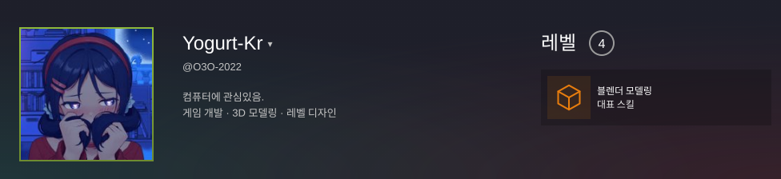
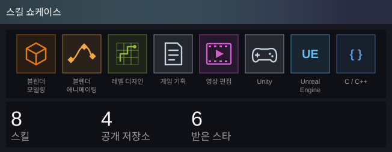
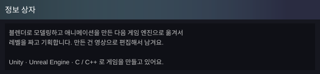
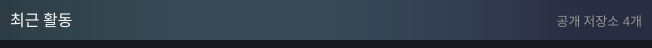
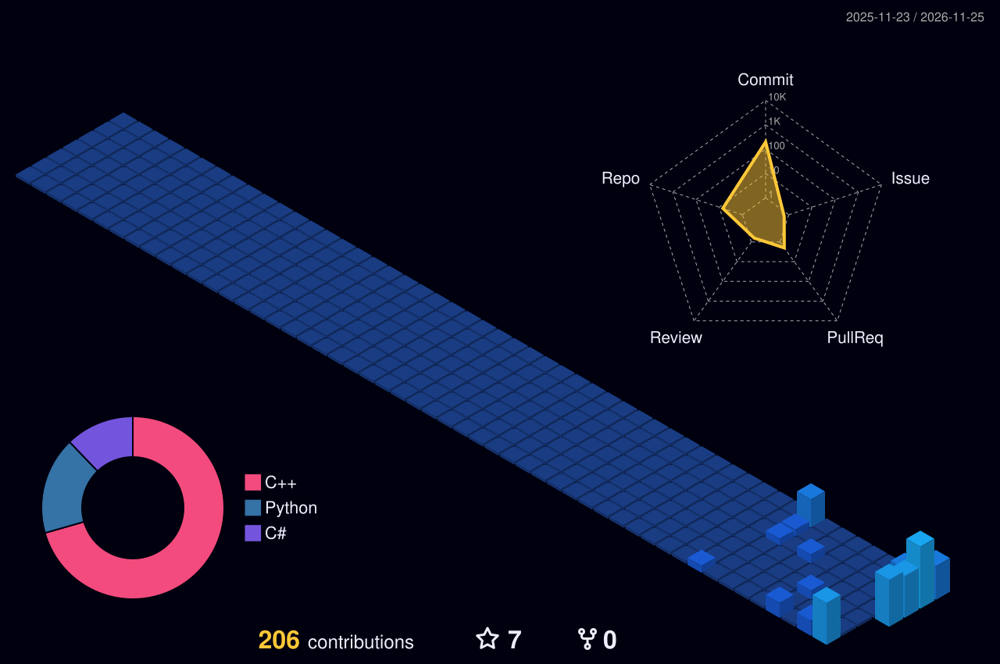

 
 
 
 
 
 
 

 

<b>활동 통계 펼치기</b>

 

<picture>
  <source media="(prefers-color-scheme: dark)" srcset="https://raw.githubusercontent.com/O3O-2022/O3O-2022/output/snake-dark.svg"/>
  <source media="(prefers-color-scheme: light)" srcset="https://raw.githubusercontent.com/O3O-2022/O3O-2022/output/snake.svg"/>
  
</picture>
